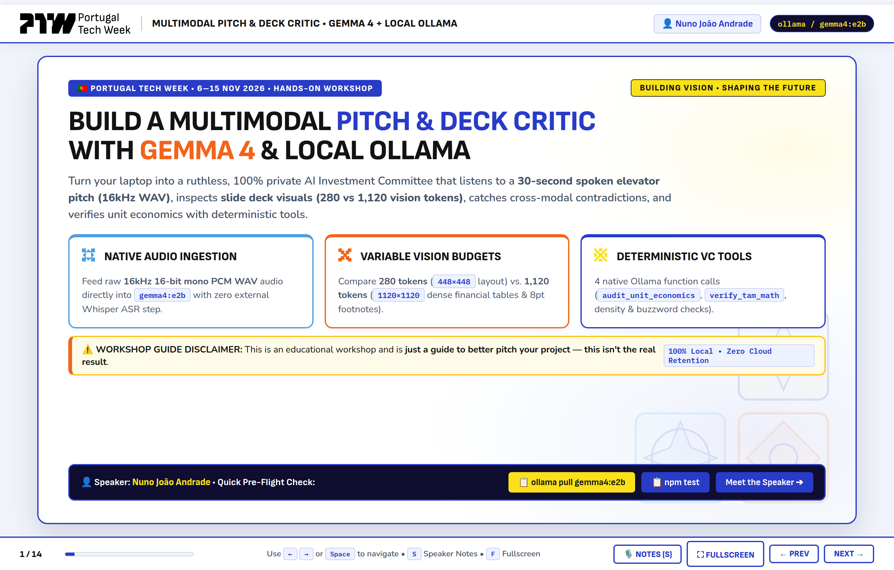
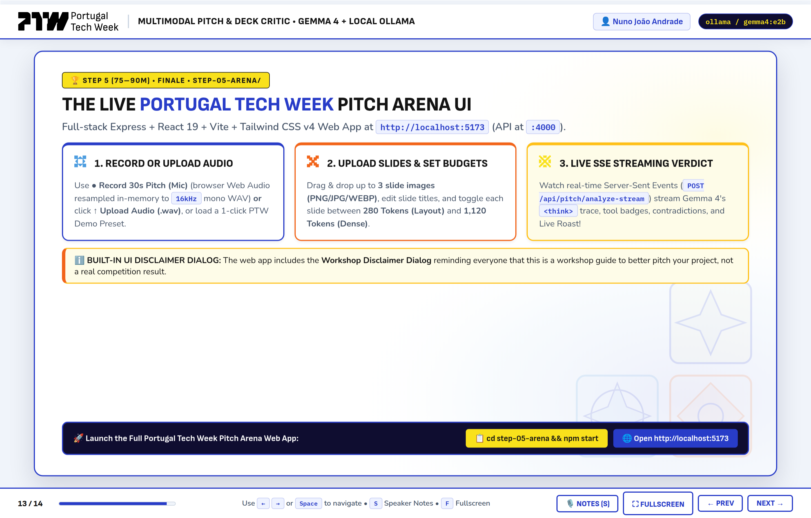
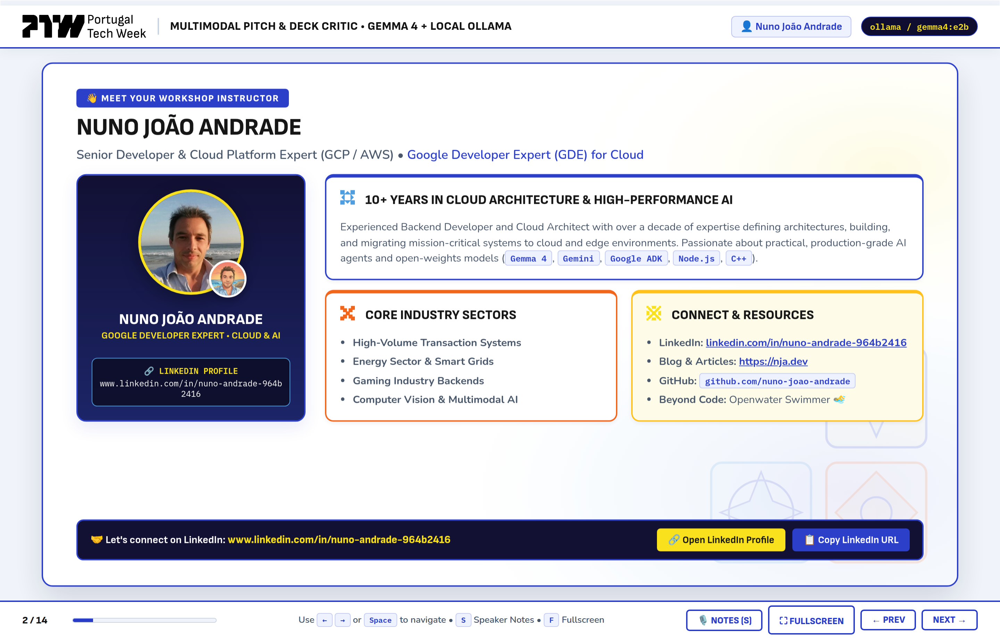

# 🇵🇹 Build a Multimodal Pitch & Deck Critic with Gemma 4 & Local Ollama
**Portugal Tech Week 2026 — Hands-On Workshop with [Nuno João Andrade](https://www.linkedin.com/in/nuno-andrade-964b2416)**

- 📦 **Workshop GitHub Repository:** [https://github.com/nuno-joao-andrade-dev/ptw_lisbon_2026](https://github.com/nuno-joao-andrade-dev/ptw_lisbon_2026)
- 🖥️ **Interactive Presentation Slides:** [https://nuno-joao-andrade-dev.github.io/ptw_lisbon_2026/slides/](https://nuno-joao-andrade-dev.github.io/ptw_lisbon_2026/slides/) *(or run `npm run slides` locally / open [`slides/index.html`](./slides/index.html))*
- 📝 **Full Technical Blog Walkthrough:** [`ARTICLE.md`](./ARTICLE.md) *(also published at [nja.dev](https://nja.dev))*
- 🙏 **Special Thanks:** A special thank you to **[Portugal Tech Week](https://portugaltechweek.com/)**, **[Kátia Sidorenko](https://www.linkedin.com/in/sidorina-katerenko/)**, and **[Laura Andrade](https://www.linkedin.com/in/lauraandrade2025/)** for the warm invitation, organization, and support in making this hands-on session in Lisbon possible!

> [!IMPORTANT]
> **⚠️ Workshop Educational Guide Disclaimer:** This project and workshop were built strictly as an **educational guide to help founders and engineers better pitch their projects** and learn multimodal AI engineering with Gemma 4. The verdicts, scores, and roasts generated by this system are **not real investment competition results or formal financial advice**.



Turn your laptop into a ruthless, **100% local, privacy-preserving AI Investment Committee ("VC Brain")** in **Node.js (ES Modules)** and **React 19** powered by **Google's Gemma 4 (`gemma4:e2b`)** running on your **Local Ollama Server (`http://localhost:11434`)**:
- **🎙️ Native Audio Ingestion (`16kHz` PCM WAV):** Feed a 30-second spoken elevator pitch directly into `gemma4:e2b` with zero external Whisper ASR step—preserving vocal pacing (WPM), hesitation cues, and filler words.
- **🖼️ Variable Vision Token Budgets (`280` vs. `1,120` Tokens):** Dynamically resize and allocate **280 tokens** (`448×448` layout mode) for simple title slides and **1,120 tokens** (`1120×1120` dense OCR mode) for multi-column financial tables and 8pt fine-print footnotes.
- **⚡ Cross-Modal Contradiction Detection:** Cross-examine what the founder *claims* on the microphone against what is *printed* on their slides.
- **🧮 Deterministic VC Financial Tools:** Eliminate LLM arithmetic hallucinations by equipping `gemma4:e2b` with 4 native Ollama tools (`audit_unit_economics`, `verify_tam_math`, `check_slide_density`, `flag_buzzword_overload`).

---

## 🗺️ The 5 Progressive Workshop Steps

The workshop is organized into **5 self-contained, ready-to-run step folders**. You can either `cd` into each folder and run `npm start`, or run `npm run step1` .. `npm run step5` directly from the root directory:

| Step | Folder | Time | Run Command (Inside Folder) | Root Shortcut | What You Will Build & Run |
| :--- | :--- | :---: | :--- | :--- | :--- |
| **Step 1** | [`step-01-setup/`](./step-01-setup/) | `00–15m` | `cd step-01-setup && npm start` | `npm run step1` | **The 20-Second "Roast My Startup" Challenge:** Verify Ollama + `gemma4:e2b`, ingest `30s WAV` audio + `Slide #1 PNG` (`280` tokens), and return a Zod-validated `RoastVerdictSchema`. |
| **Step 2** | [`step-02-narrative/`](./step-02-narrative/) | `15–35m` | `cd step-02-narrative && npm start` | `npm run step2` | **Sprint 1 — Audio Narrative Arc Critic:** Validate binary 44-byte RIFF/WAVE headers (`16kHz` mono PCM), evaluate the 5 canonical pitch beats, estimate WPM & filler words, and extract `spokenClaims`. |
| **Step 3** | [`step-03-contradictions/`](./step-03-contradictions/) | `35–55m` | `cd step-03-contradictions && npm start` | `npm run step3` | **Sprint 2 — `280` vs. `1,120` Vision Tokens & Contradictions:** Run an A/B vision token comparison on `Slide #2` and catch 4 critical contradictions between spoken claims and an 8pt financial footnote. |
| **Step 4** | [`step-04-tools/`](./step-04-tools/) | `55–75m` | `cd step-04-tools && npm start` | `npm run step4` | **Sprint 3 — Deterministic VC Tool Loop:** Execute a 2-turn Ollama tool-calling loop invoking 4 pure Node.js financial/deck audit tools before synthesizing the final `InvestmentCommitteeVerdictSchema`. |
| **Step 5** | [`step-05-arena/`](./step-05-arena/) | `75–90m` | `cd step-05-arena && npm start` | `npm run step5` | **Finale — Live Portugal Tech Week Pitch Arena UI:** Full-stack Express SSE backend (`:4000`) + React 19 UI (`:5173`) with live browser mic recording, custom slide uploads, vision budget toggles, and streaming `<think>` traces. |

---

## 🛠️ Prerequisites & One-Time Setup

### 1. Install & Start Local Ollama (`v0.20+`) with `gemma4:e2b`

Install [Ollama](https://ollama.com) and pull Google's multimodal **Gemma 4 (`gemma4:e2b`)** model:

```bash
# Start Ollama server (if not already running as a background service)
ollama serve

# Pull the multimodal Gemma 4 model (~3.5 GB)
ollama pull gemma4:e2b

# Confirm gemma4:e2b is listed locally
ollama list
```

> **💡 Low RAM / Offline Fallback Tip:**
> - If you are connecting to a shared workshop LAN Ollama server, set `export OLLAMA_HOST=http://<LAN_IP>:11434`.
> - If your laptop does not have enough RAM/VRAM or Ollama isn't installed yet, every step supports **Deterministic Offline Mock Mode** via `MOCK_OLLAMA=true` (and automatically falls back if Ollama is unreachable so no attendee is ever blocked!).

### 2. Clone the Repository, Install Dependencies & Verify

Requires **Node.js `v20.0.0+`**:

```bash
git clone https://github.com/nuno-joao-andrade-dev/ptw_lisbon_2026.git
cd ptw_lisbon_2026

# Install root & step dependencies
npm install

# Build the Portugal Tech Week React 19 Arena frontend bundle
npm run build:ui

# Run the 11-test automated verification suite
npm test
```

---

## 🚀 Detailed Step-by-Step Workshop Instructions

### Step 1 (`00–15m`): Setup & The 20-Second "Roast My Startup" Challenge

**Goal:** Confirm your local `gemma4:e2b` multimodal pipeline can ingest both a `16kHz` WAV audio clip and a slide PNG in a single request and return structured JSON validated by Zod (`RoastVerdictSchema`).

```bash
cd step-01-setup
npm start
# Or from root: npm run step1
```

**What happens under the hood (`step-01-setup/index.js`):**
1. Checks connectivity to `http://localhost:11434` (`checkOllamaStatus()`).
2. Loads **`QuantumSynergy.ai` (`fixtures/fixture_01_roast`)**:
   - `pitch_30s.wav` (`30s`, `16,000 Hz`, `16-bit`, `mono PCM WAV`) via `loadAudioInput()`.
   - `slide_01_title.png` resized to `448×448` (**280 Vision Tokens — Layout Mode**) via `loadSlideWithBudget()`.
3. Sends both modalities to `gemma4:e2b` and outputs a brutal VC roast (`HARD_PASS`, Clarity Score `22/100`) calling out 11 AI/Web4 buzzwords and the `$150M` pre-money valuation delusion.

---

### Step 2 (`15–35m`): Sprint 1 — Audio Narrative Arc & Vocal Delivery Critique

**Goal:** Analyze a founder's spoken 30-second pitch directly from raw `16kHz` PCM WAV audio without an external Whisper transcription pipeline.

```bash
cd step-02-narrative
npm start
# Or from root: npm run step2
```

**What happens under the hood (`step-02-narrative/index.js` & `shared/audioUtils.js`):**
1. `validateWavHeader()` inspects the first 44 bytes of `fixtures/fixture_02_sprint/pitch_30s.wav` (*CloudMetrics Pro*) to verify the `RIFF`/`WAVE` signature, PCM format (`1`), mono channel (`1`), `16,000 Hz` sample rate, and `16-bit` sample depth.
2. Evaluates the 5 canonical elevator pitch beats (**Problem**, **Solution**, **Traction**, **Business Model**, **The Ask**) using `NarrativeCritiqueSchema`.
3. Reports vocal delivery telemetry (`162 WPM` pacing, `2` filler words, `84/100` vocal confidence, `missingBeatWarning` on omitted GPU COGS) and extracts 4 explicit `spokenClaims` (`25% MoM growth`, `4.8x LTV:CAC`, `1.0x burn multiple`, `$90B TAM`) to pass into Step 3.

---

### Step 3 (`35–55m`): Sprint 2 — Variable Vision Token Budgets (`280` vs. `1,120`) & Cross-Modal Contradictions

**Goal:** Learn how Gemma 4's variable vision token budgets (`280` vs. `1,120` tokens) trade off prefill latency against dense OCR legibility, and catch cross-modal contradictions between spoken claims and slide fine print.

```bash
cd step-03-contradictions
npm start
# Or from root: npm run step3
```

**What happens under the hood (`step-03-contradictions/index.js` & `shared/visionBudget.js`):**
1. Runs an **A/B Vision Budget Comparison** on *CloudMetrics Pro* `slide_02_financials.png`:
   - **280 Vision Tokens (`448×448 px` — `LOW_280_LAYOUT`):** Fast layout mode for title slides (`Slide #1`), but blurs 8-point footnotes at the bottom of financial tables.
   - **1,120 Vision Tokens (`1120×1120 px` — `HIGH_1120_DENSE_OCR`):** High-resolution OCR mode for dense tables (`Slide #2` & `Slide #3`), preserving the 8pt footnote:
     > *"*Footnote: Spoken pitch figures exclude $190k/mo AWS GPU cluster costs and 4.2% monthly logo churn."*
2. Cross-examines the founder's audio claims against the `1,120`-token slides and outputs a `ContradictionReportSchema` flagging **4 critical contradictions**:
   - **`GROWTH_METRIC` (`CRITICAL`):** Claimed `25% MoM` vs. Slide #2 table showing `$220k` ➔ `$240k` (`9.1% MoM`).
   - **`UNIT_ECONOMICS` (`CRITICAL`):** Claimed `4.8x LTV:CAC` vs. Slide #2 8pt footnote hiding `$190k/mo` GPU COGS (real gross margin `20.8%`, real LTV:CAC `1.70x`).
   - **`BURN_MULTIPLE` (`CRITICAL`):** Claimed `1.0x` burn multiple vs. `$140k` net burn / `$40k` net new ARR (`3.50x`).
   - **`TAM_INFLATION` (`HIGH`):** Claimed `$90B` TAM vs. Slide #3 `15,000 ICP × $30k ACV` = `$450M` bottom-up TAM (`200×` inflation).

---

### Step 4 (`55–75m`): Sprint 3 — Multi-Turn Deterministic VC Tool Loop & Final IC Verdict

**Goal:** Ground the final Investment Committee verdict in exact mathematical formulas using a 2-turn Ollama tool-calling loop (`shared/tools.js` + `shared/client.js`).

```bash
cd step-04-tools
npm start
# Or from root: npm run step4
```

**What happens under the hood (`step-04-tools/index.js` & `shared/tools.js`):**
1. **Turn 1 (Model Requests Tool Calls):** Sends the multimodal pitch context alongside `OLLAMA_VC_TOOLS` to `gemma4:e2b`. The model emits structured `tool_calls` for:
   - `audit_unit_economics`: Computes exact `grossMarginPct` (`20.8%`), `ltvCacRatio` (`1.70x`), and `burnMultiple` (`3.50x` ➔ `FAIL`).
   - `verify_tam_math`: Computes `bottomUpTamUsd` (`$450M`) vs. `claimedTamUsd` (`$90B` ➔ `200x` inflation `FAIL`).
   - `check_slide_density`: Flags Slide #3 (`96 words` > 45-word max ➔ `WALL_OF_TEXT`).
   - `flag_buzzword_overload`: Audits transcript hype density (`PASS` with 2 buzzwords).
2. **Turn 2 (Grounded Final Verdict):** Appends the `role: 'tool'` JSON results to the conversation history and prompts `gemma4:e2b` for the final `InvestmentCommitteeVerdictSchema` (`verdict: "HARD_PASS"`, `overallIcScore: 34/100`, `liveRoast`, and `topFixRecommendation`).

---

### Step 5 (`75–90m`): Finale — The Live Portugal Tech Week Pitch Arena Web UI

**Goal:** Launch the full-stack **Express 5 SSE API Server (`:4000`) + Portugal Tech Week React 19 Web Application (`:5173`)** to test all 3 demo presets, record a live 30-second pitch from your browser microphone, or upload custom slides and WAV files!

```bash
cd step-05-arena
npm start
# Or from root: npm run step5
```

- **🌐 Web UI (Development with Vite HMR):** `http://localhost:5173`
- **⚡ Express API & Production Bundle Server:** `http://localhost:4000`
- **📊 Interactive Workshop Slides:** `http://localhost:4000/slides`



**What you can do inside the Pitch Arena UI:**
1. **⚠️ Workshop Disclaimer Dialog:** View the built-in Portugal Tech Week modal explaining that the tool is an educational workshop guide to better pitch your project, not a real competition result.
2. **🎯 1-Click Portugal Tech Week Demo Presets:** Switch between **QuantumSynergy.ai (`29/100 HARD_PASS`)**, **CloudMetrics Pro (`34/100 HARD_PASS`)**, and **VeraGrid Energy (`88/100 INVEST`)** with playable 30s audio and slide previews.
3. **🎙️ Live Browser Microphone Recording (`● Record 30s Pitch (Mic)`):** Record up to 30 seconds of live speech directly in your browser—automatically resampled in-memory via `OfflineAudioContext` (`audioResampler.js`) into a `16,000 Hz`, `16-bit`, mono PCM `.wav` file—or click **`↑ Upload Audio (.wav)`**.
4. **🖼️ Custom Slide Deck Upload & Per-Slide Token Budgets:** Drag & drop up to 3 slide images (`PNG`, `JPG`, `WEBP`), edit slide titles, and toggle each slide between **`280 Tokens (Layout)`** and **`1,120 Tokens (Dense)`**.
5. **📡 Real-Time SSE Streaming Audit (`⚡ Run Full Multimodal IC Audit`):** Watch live Server-Sent Events stream pipeline progress, Gemma 4's `<think>` reasoning trace, deterministic VC tool badges, cross-modal contradiction cards, and the final Investment Committee verdict.

---

## 🧪 Pre-Built Synthetic Startup Pitch Fixtures (`fixtures/`)

All three startup pitch packages in [`fixtures/`](./fixtures/manifest.json) include genuine `16kHz 16-bit mono PCM WAV` audio (`pitch_30s.wav`) and three `1600×900` PNG slides (`slide_01_title.png`, `slide_02_financials.png`, `slide_03_architecture.png` / `slide_03_gtm.png` / `slide_03_roadmap.png`):

| Fixture Folder | Startup Name | Pitch Profile & Intentional Trap | Expected Verdict |
| :--- | :--- | :--- | :---: |
| **[`fixtures/fixture_01_roast/`](./fixtures/fixture_01_roast)** | **QuantumSynergy.ai** | **AI/Web4 Buzzword Salad:** 11 buzzwords in 30s, zero unit economics, asking `$15M` at a `$150M` valuation on `$8k` MRR. | 🔴 **`HARD_PASS`** (`29/100`) |
| **[`fixtures/fixture_02_sprint/`](./fixtures/fixture_02_sprint)** | **CloudMetrics Pro** | **The 8pt Footnote Contradiction:** Spoken `25% MoM`, `4.8x LTV:CAC`, `1.0x` burn multiple & `$90B` TAM vs. Slide #2 `9.1% MoM`, `$190k/mo` omitted GPU COGS, `3.50x` burn multiple & `$450M` bottom-up TAM. | 🔴 **`HARD_PASS`** (`34/100`) |
| **[`fixtures/fixture_03_clean/`](./fixtures/fixture_03_clean)** | **VeraGrid Energy** | **Disciplined Seed Pitch:** Zero buzzwords, clean 3-column slides (`28–34` words), 100% consistent `18% MoM`, `78%` margin, `6.5x LTV:CAC`, `0.88x` burn multiple & `$720M` bottom-up TAM. | 🟢 **`INVEST`** (`88/100`) |

To regenerate all audio and slide PNG fixtures from scratch at any time:

```bash
npm run generate:fixtures
```

---

## 📊 Interactive Presentation Slides (`slides/`)

The repository includes a self-contained, 14-slide HTML/CSS presentation deck in [`slides/index.html`](./slides/index.html) styled with the official **Portugal Tech Week** light-mode visual identity (white background, PTW Royal Blue `#2139BA`, Coral Orange `#EC651B`, Golden Yellow `#FAD02C`, and Portuguese Azulejo geometric watermarks).

```bash
# Serve the interactive slide deck locally at http://localhost:3050
npm run slides

# Regenerate slides/images/slide-*.png SVG/PNG assets
npm run generate:slides

# Capture high-DPI 2880x1840 screenshots of all 14 slides via headless browser
npm run capture:slides
```

- **Slide Navigation:** Use `←` / `→` arrow keys or `Spacebar`.
- **Speaker Notes Drawer:** Press `S` (or click **`🎙️ Notes (S)`** in the bottom bar) to toggle instructor talking points for every slide.
- **Fullscreen Mode:** Press `F` (or click **`⛶ Fullscreen`**).
- **1-Click Copyable Commands:** Click any terminal command pill at the bottom of a slide to copy it to your clipboard.

---

## 📂 Complete Repository Structure

```text
ptw_lisbon_2026/
├── shared/                              # Shared multimodal utilities, Ollama client & Zod schemas
│   ├── config.js                        # Central Ollama host, gemma4:e2b model & vision budget config
│   ├── client.js                        # Ollama API client, <think> parser, 2-turn tool loop & mock fallback
│   ├── audioUtils.js                    # Binary 44-byte RIFF/WAVE PCM header validator & base64 loader
│   ├── visionBudget.js                  # Sharp image resizer for 280 (448px) vs 1,120 (1120px) vision tokens
│   ├── tools.js                         # 4 deterministic VC functions + Ollama JSON tool schemas
│   └── schemas.js                       # Zod schemas for Roast, Narrative, Contradictions & IC Verdict
├── fixtures/                            # Pre-generated 16kHz WAV audio & 1600×900 PNG slide decks
│   ├── manifest.json                    # Structured ground-truth metadata for all 3 startup fixtures
│   ├── fixture_01_roast/                # QuantumSynergy.ai (AI Hype Overload — Score: 29/100)
│   ├── fixture_02_sprint/               # CloudMetrics Pro (Hidden 8pt Footnote Trap — Score: 34/100)
│   └── fixture_03_clean/                # VeraGrid Energy (Disciplined Climate-Tech — Score: 88/100)
├── step-01-setup/                       # Step 1 (00–15m): 20-Second "Roast My Startup" Challenge
│   ├── index.js
│   └── package.json
├── step-02-narrative/                   # Step 2 (15–35m): Sprint 1 — Audio Narrative Arc Critic
│   ├── index.js
│   └── package.json
├── step-03-contradictions/              # Step 3 (35–55m): Sprint 2 — 280 vs 1,120 Vision Tokens & Contradictions
│   ├── index.js
│   └── package.json
├── step-04-tools/                       # Step 4 (55–75m): Sprint 3 — Multi-Turn Deterministic VC Tool Loop
│   ├── index.js
│   └── package.json
├── step-05-arena/                       # Step 5 (75–90m): Finale — Express SSE + Portugal Tech Week React 19 UI
│   ├── index.js                         # Launches Express API (:4000) + Vite Dev Server (:5173)
│   ├── server.js                        # Express REST & SSE streaming server (/api/pitch/analyze-stream)
│   ├── vite.config.js                   # Vite + React 19 + Tailwind CSS v4 configuration
│   └── client/                          # Portugal Tech Week React 19 frontend source
├── slides/                              # Interactive 14-slide Portugal Tech Week HTML deck & screenshots
│   ├── index.html                       # Self-contained interactive browser slide deck
│   ├── SLIDES.md                        # Markdown companion slide deck & speaker script
│   └── images/                          # High-DPI PNG screenshots of all 14 slides (slide-01..14.png)
├── scripts/                             # Fixture & slide generation utilities
│   ├── generate-fixtures.js             # Generates 16kHz WAVs & Sharp SVG->PNG slide decks
│   ├── generate-workshop-slides.js      # Generates SVG/PNG slide visuals
│   ├── capture-slide-screenshots.js     # Captures 2880x1840 screenshots from slides/index.html
│   └── serve-slides.js                  # Lightweight static HTTP server for slides/index.html (:3050)
├── tests/                               # Node.js automated test suite (11/11 tests)
│   ├── unit.test.js                     # Unit tests for WAV headers, vision budgets, Zod schemas & VC tools
│   └── integration.test.js              # End-to-end API & fixture integration tests
├── ARTICLE.md                           # Full-length technical blog post & architectural deep dive
├── WORKSHOP_PLAN.md                     # Workshop curriculum & timing blueprint
└── README.md                            # This workshop guide
```

---

## 🔧 Troubleshooting & Command Cheat Sheet

| Symptom | Root Cause | Quick Fix |
| :--- | :--- | :--- |
| `Connection refused` on `http://localhost:11434` | Local Ollama server is not running, or machine lacks sufficient RAM/VRAM. | Run `ollama serve` in a separate terminal, or run any step with `MOCK_OLLAMA=true` (automatic mock fallback is also enabled by default if Ollama is unreachable). |
| Model misses the 8pt footnote on Slide #2 (`slide_02_financials.png`) | Slide #2 was inspected using the `280`-token (`448×448`) layout budget instead of `1,120` tokens. | Toggle Slide #2 to **`1,120 Tokens (Dense)`** (`1120×1120`) in the UI or pass `CONFIG.visionBudgets.HIGH_DENSE_OCR` (`1120`) to `loadSlideWithBudget()`. |
| Browser microphone button is disabled or fails | Browser blocked `navigator.mediaDevices.getUserMedia` or page wasn't opened via `localhost`. | Open `http://localhost:5173` (or `http://localhost:4000`), allow microphone permissions, or click **`↑ Upload Audio (.wav)`** and pick any `.wav` file from `fixtures/`. |
| Port `4000` or `5173` is already in use | Previous Step 5 process is still running in the background. | Stop the previous terminal process (`Ctrl+C`) or run `PORT=4050 npm run step5`. |

### Quick Command Cheat Sheet

```bash
# Run all 11 automated unit & integration tests
npm test

# Run each progressive workshop step
npm run step1          # Step 1: 20-Second Startup Roast (QuantumSynergy.ai)
npm run step2          # Step 2: Audio Narrative Arc Critic (CloudMetrics Pro)
npm run step3          # Step 3: 280 vs 1,120 Vision Tokens & Contradictions
npm run step4          # Step 4: 4 Deterministic VC Tools & Final IC Verdict
npm run step5          # Step 5: Full-Stack Portugal Tech Week Pitch Arena UI

# Open the 14-slide interactive presentation deck at http://localhost:3050
npm run slides

# Run any step in deterministic Offline Mock Mode (no GPU / Ollama required)
MOCK_OLLAMA=true npm run step4
```

---

## 👤 Connect with the Instructor & Special Thanks



- **Instructor:** **Nuno João Andrade** — Senior Backend Developer, Cloud Platform Expert (GCP / AWS), and **Google Developer Expert (GDE) for Cloud**
- **LinkedIn:** [https://www.linkedin.com/in/nuno-andrade-964b2416](https://www.linkedin.com/in/nuno-andrade-964b2416)
- **Blog & Articles:** [https://nja.dev](https://nja.dev)
- **Special Thanks:** Huge thanks to **[Portugal Tech Week](https://portugaltechweek.com/)**, **[Kátia Sidorenko](https://www.linkedin.com/in/sidorina-katerenko/)**, and **[Laura Andrade](https://www.linkedin.com/in/lauraandrade2025/)** for making this workshop possible!
