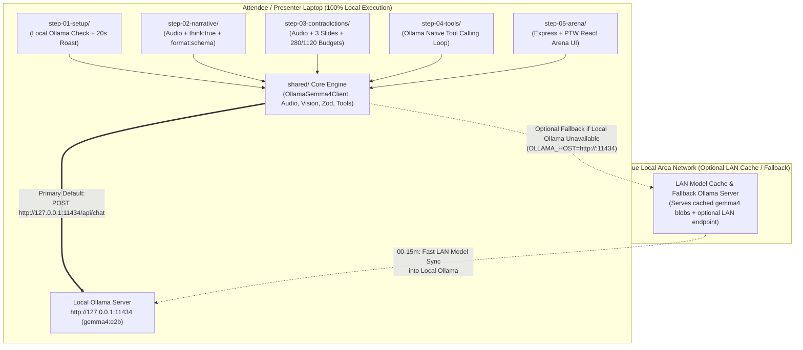

# System & Workshop Specification: Multimodal Pitch & Deck Critic with Gemma 4 + Local Ollama (Node.js & React)

**Event:** Portugal Tech Week (90-Minute Hands-On Workshop) — [portugaltechweek.com](https://portugaltechweek.com/)  
**Source Requirements:** [`agent.md`](file:///home/nja/projects/nja.dev/portugal_tech_week/pitch/agent.md)  
**Target Stack:** Node.js (ES Modules JavaScript, Express, Ollama HTTP API, Zod, Sharp, Wavefile) + React (Vite, Tailwind CSS, Web Audio API)  
**Target Model & Runtime:** **Gemma 4 (`gemma4:e2b` default / `gemma4:e4b` compatible) running on a Local Ollama Server (`http://127.0.0.1:11434`)**  
**Workshop Interaction Model:** 5 Self-Contained Step Folders (`step-01-setup` through `step-05-arena`) — enter the folder and run `npm start` (or `node index.js`)

---

## 1. Executive Summary & 5-Step Workshop Experience

### 1.1 Product Vision & Why Local Ollama (`gemma4:e2b`) + Node.js
Build a **100% private, local-first AI Investment Committee ("VC Brain")** in **Node.js (JavaScript) and React** powered by **Gemma 4 (`gemma4:e2b`) running on the attendee's local Ollama server (`http://127.0.0.1:11434`)**.

Why **Local Ollama (`gemma4:e2b`) + Node.js** is ideal for attendee laptops:
- **Fits Easily in 8GB RAM Laptops (`4.6 GB` `Q4_K_M`)**: `gemma4:e2b` includes the full `475.73M` multimodal projector and native capabilities (`completion`, `vision`, `audio`, `tools`, `thinking`) with a `131,072` context window, while running ~2x faster than `e4b`.
- **Zero Python / CUDA / C++ Build Failures**: Ollama (`http://127.0.0.1:11434`) handles hardware acceleration in a single binary, and Node.js communicates with it via standard HTTP `fetch()`.

### 1.2 The 5-Step Folder Workflow
The repository is organized into **5 sequential step folders** mapped 1-to-1 to the 90-minute Run of Show in [`agent.md`](file:///home/nja/projects/nja.dev/portugal_tech_week/pitch/agent.md).

Every step works **out of the box** against the local Ollama server (`http://127.0.0.1:11434`) using shared root `node_modules` (only one `npm install` at the root is needed) and clearly marked `// WORKSHOP TWEAK:` sections:

| Step Folder | Workshop Time | Run of Show Stage | How to Execute | What Happens When Executed |
| :--- | :--- | :--- | :--- | :--- |
| **`step-01-setup/`** | `00–15m` | **Live Roast & Architecture Setup** | `cd step-01-setup && npm start` | Connects to the **local Ollama server (`http://127.0.0.1:11434`)**, verifies `gemma4:e2b` (or `gemma4:e4b`), validates audio/image pipelines, and runs a live offline roast on a 20s pitch + 1 slide (`fixture_01_roast`). |
| **`step-02-narrative/`** | `15–35m` | **Sprint 1: Narrative Structure Analyzer** | `cd step-02-narrative && npm start` | Calls local Ollama (`http://127.0.0.1:11434/api/chat`) with a 30s `.wav` pitch, **Thinking Mode (`think: true`)**, and **Strict JSON Schema (`format`)** to score `Hook`, `Problem`, `Solution`, `Traction`, `Ask`, and `Story Arc`. |
| **`step-03-contradictions/`** | `35–55m` | **Sprint 2: Multimodal Contradiction Detection** | `cd step-03-contradictions && npm start` | Feeds 30s `.wav` audio + 3 slide images into local Ollama (`gemma4:e2b`), runs an A/B comparison of **`280` vs. `1120` vision token budgets**, and catches fine-print contradictions between spoken claims and slide metrics. |
| **`step-04-tools/`** | `55–75m` | **Sprint 3: Deterministic VC Tool Calls** | `cd step-04-tools && npm start` | Registers 4 native JavaScript VC tools (`audit_unit_economics`, `verify_tam_math`, `check_slide_density`, `flag_buzzword_overload`) via local Ollama's `tools` API, executes the 2-turn tool loop, and prints the verified `HARD_PASS` verdict. |
| **`step-05-arena/`** | `75–90m` | **The Live Pitch Arena Finale** | `cd step-05-arena && npm start` | Launches the **Express Backend + Portugal Tech Week React Web UI** connected to the local Ollama server (`http://127.0.0.1:11434`) with live 30s microphone recording, 3-slide upload, live Thinking/Tool stream, and the Pitch Scorecard. |

---

## 2. System Architecture & Local Ollama Execution Model

### 2.1 High-Level Architecture



### 2.2 Local Ollama Server Connection & Auto-Detection (`shared/config.js` & `shared/client.js`)
1. **Primary Default Endpoint (`http://127.0.0.1:11434`)**:
   - Defaults to `OLLAMA_HOST=http://127.0.0.1:11434` and `OLLAMA_MODEL=gemma4:e2b`.
2. **Automatic Local Model Tag Resolution (`GET /api/tags`)**:
   - Queries `http://127.0.0.1:11434/api/tags` on startup and matches `gemma4:e2b` (or automatically falls back to `gemma4:e4b` / any installed `gemma4*` model).
   - Verifies capabilities (`completion`, `vision`, `audio`, `tools`, `thinking`) via `POST http://127.0.0.1:11434/api/show`.

---

## 3. Mapping Gemma 4 Capabilities to the Local Ollama API (`/api/chat`)

### 3.1 Local Ollama `/api/chat` Request Contract
All 5 steps call the local Ollama server (`POST http://127.0.0.1:11434/api/chat`) via `shared/client.js`:

```javascript
// POST http://127.0.0.1:11434/api/chat
{
  model: resolvedModelName, // Default: "gemma4:e2b" (auto-compatible with "gemma4:e4b")
  messages: [
    { role: 'system', content: systemPrompt },
    {
      role: 'user',
      content: userPrompt,
      // In Ollama /api/chat, both base64 PNG/JPEG slide images AND base64 RIFF/WAVE 16kHz audio
      // are passed in `images` (Ollama inspects magic headers to route images vs USM audio)
      images: [base64Slide1, base64Slide2, base64Slide3, base64Wav16kHzMono]
    }
  ],
  think: true,                                            // Gemma 4 Configurable Thinking Mode in Ollama
  format: jsonSchemaObject,                               // Strict Zod JSON Schema (Steps 2, 3, and Turn 2 of Steps 4 & 5)
  tools: ollamaToolDefinitions,                           // Native Function Calling (Turn 1 of Steps 4 & 5)
  stream: true,
  options: {
    temperature: 0.1,
    num_ctx: 8192
  }
}
```

### 3.2 Spoken Elevator Pitch Ingestion (Native `.wav` Audio + Local Ollama)
- **Audio Input Standard**: `16,000 Hz`, 16-bit mono PCM `.wav` (`20s–30s`, hard cap at `35.0s`).
- **Node.js Validation (`shared/audioUtils.js`)**:
  - Uses pure-JS **`wavefile`** (zero native `ffmpeg` dependency) to validate RIFF/WAVE headers, resample to `16kHz` mono PCM, normalize peak amplitude, and encode as base64.
- **Browser Web Audio Recorder in Step 5 (`step-05-arena/client/src/utils/audioRecorder.js`)**:
  - Uses `AudioContext` + `OfflineAudioContext` in React to capture microphone input with a 30-second countdown timer and encode `16kHz` mono `.wav` directly in the browser.

### 3.3 Slide Deck Visual Audit (Variable Vision Token Budgets: `280` vs. `1120`)
`shared/visionBudget.js` enforces the exact `280` vs. `1120` token budgets using **`sharp`** before base64-encoding images for Ollama's `messages[].images` array:

| Budget Tier | Vision Tokens | Target Slide Type | Node.js `sharp` Pre-Processing for Local Ollama `images[]` | Pedagogical & Runtime Effect |
| :--- | :--- | :--- | :--- | :--- |
| **Layout Budget** | `280` tokens | Title slides, big-statement hook slides, team slides, simple 3-bullet value props | Downscales slide to a single base vision tile (`448x448` JPEG/PNG, quality 80) | Fast prefill on local Ollama (`280` vision tokens), low memory, intentionally blurs 8pt footnotes on dense tables |
| **Dense Budget** | `1120` tokens | Financial tables, unit economics breakdowns, cohort charts, system architecture diagrams | Preserves high-resolution $2 \times 2$ multi-tile grid (`1120x1120` / `896x896` lossless PNG, $4 \times 280$ tokens) | Allocates full `1120` vision tokens on local Ollama so Gemma 4 reads 8pt footnotes, table cells, and axis labels |

---

## 4. Data Contracts & Strict Zod Schemas (`shared/schemas.js`)

All structured outputs are defined using **Zod** (`zod`) and converted to JSON Schema objects passed directly into the local Ollama `/api/chat` `format` parameter:

1. **`NarrativeStructureSchema` (Step 2)**:
   - `transcriptSummary`: Verbatim or near-verbatim transcript of the 30s spoken pitch.
   - `hook`, `problem`, `solution`, `traction`, `ask`: Each contains `{ score (0-10), spokenQuote, timestampRange, critique }`.
   - `storyArc`: `{ overallArcScore (0-100), sequenceCoherent (boolean), missingBeats[], pacingDiagnosis }`.
2. **`MultimodalContradictionSchema` (Step 3)**:
   - `narrative`: `NarrativeStructureSchema`.
   - `slideAudits`: Array of `{ slideIndex, slideTitle, visionTokenBudgetUsed (280|1120), detectedDensityScore, keyVisualMetrics[], finePrintDetected }`.
   - `contradictions`: Array of `{ contradictionId, category, spokenClaim, spokenTimestamp, slideIndex, slideEvidence, severity ('MINOR'|'MAJOR'|'FATAL_BS'), vcCallOut }`.
   - `crossModalAlignmentScore`: `0–100`.
3. **`InvestmentCommitteeVerdictSchema` (Steps 1, 4 & 5)**:
   - Combines `narrative`, `slideAudits`, `contradictions`, and `toolAudits` (`audit_unit_economics`, `verify_tam_math`, `check_slide_density`, `flag_buzzword_overload`) with:
   - `overallIcScore` (`0–100`), `verdict` (`'INVEST' | 'DIG_DEEPER' | 'HARD_PASS'`), `liveRoast` (2–3 sentence punchy VC roast), and `topFixRecommendation`.

---

## 5. Deterministic VC Tool Suite ("Bullshit Detector") (`shared/tools.js`)

1. **`audit_unit_economics`** (consolidates `calculate_burn_multiple`):
   - Computes $\text{Annual Net Burn} = \text{monthlyNetBurnUsd} \times 12$ and $\text{Actual Burn Multiple} = \text{Annual Net Burn} / \text{netNewArrUsd}$.
   - Flags `FAIL` (`CAPITAL_INCINERATOR`) if Burn Multiple $> 3.0\text{x}$ or if claimed burn multiple differs from actual by $> 0.25\text{x}$.
2. **`verify_tam_math`**:
   - Computes $\text{Bottom-Up TAM} = \text{targetCustomerCount} \times \text{annualPricePerCustomerUsd}$ and compares against `claimedTamUsd`. Flags `FAIL` if inflation ratio $> 1.25\text{x}$.
3. **`check_slide_density`**:
   - Evaluates word count and data points per slide (`FAIL` if `> 75` words or `> 18` data points; recommends `1120` vision tokens for dense slides).
4. **`flag_buzzword_overload`**:
   - Scans spoken pitch + slide headers against the VC hype lexicon and computes `buzzwordsPerMinute` (`FAIL` if $\ge 5$ hits in a 30s pitch).

---

## 6. Frontend Specification (`step-05-arena/client/`) — Simple & Clean Portugal Tech Week Design

The React frontend in `step-05-arena/client/` is designed to be **minimalist, high-contrast, fast to scan on both a laptop and a 1080p stage projector**, and styled directly with the authentic **Portugal Tech Week ([portugaltechweek.com](https://portugaltechweek.com/))** visual identity.

### 6.1 Portugal Tech Week Brand & Design Tokens

Extracted directly from `https://portugaltechweek.com/` (`post-95.css`, `post-730.css`, `post-764.css`, `post-2205.css`, and inline `STYLE 4` / `STYLE 5` / `STYLE 15–19`) and bundled with official visual assets in `step-05-arena/client/public/ptw/`:

| Token Category | CSS Variable / Asset | Hex / Value | Usage in the Pitch Critic UI |
| :--- | :--- | :--- | :--- |
| **Sticky White Top Navbar** | `.ptw-navbar` + `/ptw/ptw-logo-black.png` | `#FFFFFF` bg, `#131313` text (`height: 80px`) | Full-width sticky white top bar with the official black PTW horizontal logo, `Sofia Sans` `20px` `600` nav links, Local Ollama status pill, and Reset CTA |
| **Ambient Page Canvas** | `--ptw-dark` + `/ptw/bg-ptw.jpg` | `#131313` + `bg-PTW-2025.jpg` (`fixed cover`) | Official Portugal Tech Week dark radial blue/gold ambient background canvas |
| **Hero Banner & Azulejo Tiles** | `.ptw-hero-banner` + `/ptw/hero-frame.png` + `/ptw/tile-*.svg` | `PORTUGAL TECH WEEK` / `BUILDING VISION · SHAPING THE FUTURE` | Two-column split display hero in `Sofia Sans` `800`/`400` + 3 official Portuguese Azulejo tile SVGs (`tile-sky.svg` `#4D9DE0`, `tile-orange.svg` `#F26419`, `tile-yellow.svg` `#F9E11B`) |
| **Portuguese Cities Ticker** | `.city-ticker` (`Poppins` `18px`) | `#FFFFFF` uppercase cities + `#FFD700` 4-point star SVGs | Continuous horizontal marquee (`LISBOA ★ PORTO ★ BRAGA ★ COIMBRA ★ AVEIRO ★ FARO...`) |
| **Palace / Agenda Card Surface** | `--ptw-card` (`.ptw-card`) | `#0F0D30` (`border: 2px solid #283CC8`, `12px` radius) | All primary panels and cards, matching `.etn-event-item` on `portugaltechweek.com` |
| **Primary CTA Button** | `.ptw-btn-primary` | `#283CC8` bg, `#FFFFFF` text, `5px` radius → `:hover` `#F9E11B` bg, `#131313` text | `#btn-analyze-pitch`, `#btn-audio-record`, and `#btn-reset-session` (`Sofia Sans` bold) |
| **Secondary Outline Button** | `.ptw-btn-outline` | `transparent` bg, `1px solid #FFFFFF`, `5px` radius → `:hover` `#F9E11B` bg, `#131313` text | `↑ Upload Audio (.wav)` button |
| **PTW Agenda Preset Pills** | `.ptw-agenda-btn` | `#000000` bg, `#FF7400` text, `10px` radius → `.is-active` `#FEFF00` border & text | `#btn-load-fixture-1`, `#btn-load-fixture-2`, `#btn-load-fixture-3` |
| **PTW Agenda Track / Budget Pills** | `.ptw-agenda-track-btn` | `#0F0D30` bg, `#4E9DE0` text, `10px` radius → `.is-active` `#283CC8` border, `#FFFFFF` text | Per-slide `280 Tokens • Layout` vs. `1120 Tokens • Dense` buttons |
| **Community Footer Strip** | `/ptw/ptw-logo-black.png` + `/ptw/351-logo-white.png` | `#FFFFFF` community banner + `#08071A` organizer bar | Official `BE PART OF THE PORTUGAL TECH WEEK COMMUNITY` white strip & `351 Portuguese Startup Association` footer |
| **Typography** | `--font-display` / `--font-ticker` / `--font-body` / `--font-mono` | `"Sofia Sans"` (`300–800`), `"Poppins"`, `"Nunito"`, `"IBM Plex Mono"` | Official PTW font stack loaded via Google Fonts |

### 6.2 Simple, Clean 2-Column Layout Structure

Instead of a crowded multi-pane dashboard, the UI uses a **clean 2-column layout** (`max-width: 1280px`, `20px` grid gap, `12px` card radius, `2px` `#283CC8` borders) with a top Portugal Tech Week header bar:

```text
+---------------------------------------------------------------------------------------------------+
| [PTW 2026 BADGE]  MULTIMODAL PITCH & DECK CRITIC          [● Local Ollama: gemma4:e2b] [Reset ↺]  |
+---------------------------------------------+-----------------------------------------------------+
| LEFT COLUMN: PITCH INPUTS (42% Width)       | RIGHT COLUMN: VC BRAIN & VERDICT (58% Width)        |
|                                             |                                                     |
| 0. STARTUP INFO & QUICK-LOAD TEST MATERIAL  | 1. VERDICT & LIVE ROAST HERO CARD (#0F0D30)         |
| +-----------------------------------------+ | +-------------------------------------------------+ |
| | Startup: [CloudMetrics Pro            ] | | | [HARD PASS]                     IC SCORE: 22/100| |
| | Founder: [Alex Rivera (CEO)           ] | | | "Your spoken 1.0x burn multiple is pure fiction | |
| | Quick Load: [Test 1] [Test 2] [Test 3]  | | |  when Slide 2 shows $350K/mo burn ($4.2M/yr)..."| |
| +-----------------------------------------+ | +-------------------------------------------------+ |
|                                             |                                                     |
| 1. SPOKEN ELEVATOR PITCH (Record OR Upload) | 2. CONTRADICTIONS & DETERMINISTIC TOOL CHECKS       |
| +-----------------------------------------+ | +-------------------------------------------------+ |
| | [● Record 30s Mic] [↑ Upload .WAV File] | | | ⚡ CONTRADICTION (FATAL_BS) • Slide 2 @ 00:14    | |
| | [▶ Play] pitch_30s.wav (28.1s • 16kHz)  | | | Said: "1.0x burn multiple" vs Slide: "$350K/mo" | |
| | ▁▂▄▆█▄▂▁▃▅▇▃▁▅▇▄▂▁             [✕ Clear]| | +-------------------------------------------------+ |
| +-----------------------------------------+ | | [✗ Burn Multiple: 3.5x] [✗ TAM Math: 200x Off]  | |
|                                             | | [✗ Slide 3: 96 Words]   [✓ Buzzwords: 1 hit]    | |
| 2. SLIDE DECK UPLOAD (1–3 Slides, PNG/JPG)  | +-------------------------------------------------+ |
| +-----------------------------------------+ |                                                     |
| | [+ Upload Slides (PNG/JPG/WEBP, Max 3)] | | 3. NARRATIVE ARC SCORES (0-10) & <THINK> DRAWER     |
| | #1 [Thumb] Title: [Title & Hook  ]      | | +-------------------------------------------------+ |
| |    Budget: [280 Layout] [1120] [↺] [✕]  | | | Hook 8 | Problem 7 | Solution 7 | Trac 4 | Ask 3| |
| | #2 [Thumb] Title: [Financials    ]      | | | [▸ View Gemma 4 Thinking Trace (IBM Plex Mono)] | |
| |    Budget: [280] [1120 Dense]  [↺] [✕]  | | +-------------------------------------------------+ |
| | #3 [Thumb] Title: [Architecture  ]      | |                                                     |
| |    Budget: [280] [1120 Dense]  [↺] [✕]  | |                                                     |
| +-----------------------------------------+ |                                                     |
|                                             |                                                     |
| [⚡ ANALYZE PITCH WITH GEMMA 4 (#FFC017)  ] |                                                     |
+---------------------------------------------+-----------------------------------------------------+
```

### 6.3 Complete Input Fields, File Uploaders & Action Buttons Specification

Every interactive control in `<PitchInputCard />` and `<PtwHeader />` is explicitly specified below so users can **record live audio AND/OR upload an audio file**, **upload/manage up to 3 slide images**, or **1-click load pre-generated test fixtures**:

#### A. Pitch Metadata & Test Fixture Quick-Load Controls
| Field / Button ID | Element Type | Label / Placeholder | Behavior & Validation |
| :--- | :--- | :--- | :--- |
| `input-startup-name` | `<input type="text">` | Placeholder: `"e.g., CloudMetrics Pro"` | Editable startup name sent in the analysis request metadata (`startupName`). |
| `input-founder-name` | `<input type="text">` | Placeholder: `"e.g., Alex Rivera (CEO)"` | Optional founder/presenter name (`founderName`) displayed on the Verdict Card. |
| `btn-load-fixture-1` | `<button type="button">` | `🔥 Test 1: QuantumSynergy (20s)` | Loads `fixtures/fixture_01_roast/pitch_20s.wav` + `slide_1.png` into the form state. |
| `btn-load-fixture-2` | `<button type="button">` | `🧪 Test 2: CloudMetrics (30s)` | Loads `fixtures/fixture_02_sprint/pitch_30s.wav` + `slide_1.png`, `slide_2.png`, `slide_3.png`. |
| `btn-load-fixture-3` | `<button type="button">` | `✅ Test 3: VeraGrid (30s)` | Loads `fixtures/fixture_03_clean/pitch_30s.wav` + `slide_1.png`, `slide_2.png`, `slide_3.png`. |
| `btn-reset-session` | `<button type="button">` | `↺ Reset / Custom Pitch` | Clears current audio, slides, and verdict state in memory (`POST /api/session/reset`). |

#### B. Spoken Elevator Pitch Controls (Record Live Mic AND/OR Upload Audio)
Users can either record their voice directly from the browser microphone **or** upload a pre-recorded audio file from disk (or switch between both at any time):

| Field / Button ID | Element Type | Label / Icon | Behavior & Validation |
| :--- | :--- | :--- | :--- |
| `btn-audio-record` | `<button type="button">` | `● Record 30s Pitch` (Idle) / `■ Stop Recording (00:18)` (Active) | Requests `navigator.mediaDevices.getUserMedia({ audio: true })`, starts a 30-second countdown timer (`#FFC017` border pulse) and live `#4E9DE0` Web Audio waveform canvas, and encodes PCM samples directly into a `16,000 Hz`, 16-bit mono `.wav` `Blob` in browser memory. Automatically stops at `30.0s`. |
| `input-audio-upload` | `<input type="file" accept=".wav,audio/wav,audio/x-wav,audio/webm,audio/mp3">` + `<label>` button | `↑ Upload Audio (.wav)` | Opens native file picker (or accepts drag-and-drop onto the Audio Zone). Accepts `.wav` directly (or decodes browser-supported audio via `AudioContext.decodeAudioData` and resamples to `16kHz` mono PCM `.wav`). Rejects files `> 10 MB` or `> 35s` with an inline `#FF3B5C` error banner. |
| `btn-audio-play-pause` | `<button type="button">` | `▶ Play` / `⏸ Pause` | Plays or pauses the currently recorded or uploaded `.wav` buffer so the user or audience can hear the pitch before or after analysis. |
| `badge-audio-telemetry` | `<span>` (Read-only status) | e.g., `pitch_30s.wav • 28.1s • 16kHz Mono PCM` | Displays filename (`recorded_pitch.wav` or uploaded filename), exact duration in seconds, and sample-rate badge in `IBM Plex Mono`. |
| `btn-audio-clear` | `<button type="button">` | `✕ Remove Audio` | Clears the active audio `Blob`/file so the user can re-record or upload a different `.wav` file. |

#### C. Slide Deck Upload & Per-Slide Controls (1 to 3 Slides)
Users can upload 1 to 3 pitch deck slides via multi-file picker or drag-and-drop, inspect thumbnails, edit slide titles, and toggle each slide's Gemma 4 vision token budget:

| Field / Button ID | Element Type | Label / Icon | Behavior & Validation |
| :--- | :--- | :--- | :--- |
| `input-slides-upload` | `<input type="file" accept="image/png,image/jpeg,image/webp" multiple>` + Dropzone `<label>` | `+ Upload Slides (.png, .jpg, .webp — Max 3)` | Supports clicking to browse or dragging & dropping 1–3 slide images (`<= 5 MB` each). Automatically runs a client/server density pre-check to suggest `280` (Layout) vs. `1120` (Dense) vision tokens. Disabled when 3 slides are already loaded (`3/3 Slides Loaded`). |
| `input-slide-title-{i}` | `<input type="text">` (Per slide `i = 1..3`) | Placeholder: `"Slide 1 Title (e.g., Financials)"` | Editable label for Slide `#1`, `#2`, `#3` so contradiction cards reference human-readable slide names alongside slide numbers. |
| `btn-slide-budget-280-{i}` | `<button type="button">` (Segmented pill toggle) | `280 Tokens • Layout` | Forces Slide `i` to be resized to `448×448` (`280` vision tokens) for fast layout/title inspection. Active state uses `#283CC8` fill. |
| `btn-slide-budget-1120-{i}` | `<button type="button">` (Segmented pill toggle) | `1120 Tokens • Dense` | Forces Slide `i` to preserve `1120×1120` high-res detail (`1120` vision tokens) for dense financial tables, fine print, and architecture diagrams. Active state uses `#4E9DE0` border + `#0F0D30` fill. |
| `btn-slide-replace-{i}` | `<button type="button">` + hidden `<input type="file">` | `↺ Replace` | Replaces only Slide `i` with a new `.png`/`.jpg`/`.webp` image from disk while keeping its slot position. |
| `btn-slide-remove-{i}` | `<button type="button">` | `✕ Remove` | Removes Slide `i` from the deck array and re-indexes remaining slides (`1..N`). |

#### D. Primary Analysis & Streaming Control Buttons
| Field / Button ID | Element Type | Label / Styling | Behavior & Validation |
| :--- | :--- | :--- | :--- |
| `btn-analyze-pitch` | `<button type="submit">` | `⚡ ANALYZE PITCH WITH GEMMA 4` (`background: #283CC8`, hover `#F9E11B`, `Sofia Sans` bold) | Enabled only when `audioBlob != null` AND `slides.length >= 1`. Submits `Multipart/Form-Data` (`audio`, `slides[]`, `slideMeta[]`, `startupName`, `founderName`) to `POST /api/pitch/analyze-stream` and opens the live SSE stream from Local Ollama (`gemma4:e2b`). |
| `btn-cancel-analysis` | `<button type="button">` | `■ Cancel Analysis` (`background: #FF3B5C`, shown only while streaming) | Aborts the active `AbortController` fetch stream and stops the in-flight Ollama generation request. |
| `dialog-workshop-disclaimer` | `<div role="dialog" aria-modal="true">` | `Workshop Guide Only — Not a Real Result` | Modal dialog shown on startup (and reopenable via `btn-open-workshop-dialog`) explicitly stating that this is a Portugal Tech Week workshop and is just a guide to help better pitch your project — not a real investment or competition result. Dismissed via `btn-close-workshop-dialog`. |

### 6.4 Minimalist Component Breakdown (`step-05-arena/client/src/`)
Only **5 focused components** inside `App.jsx` to keep the React code clean, readable, and easy for workshop attendees to inspect:

1. **`<WorkshopDisclaimerDialog />`**:
   - Modal dialog (`#dialog-workshop-disclaimer`) displayed on load stating clearly that this is a workshop educational tool and is **just a guide to better pitch your project, not the real result**. Can be reopened anytime from the header (`#btn-open-workshop-dialog`).
2. **`<PtwHeader />`**:
   - Displays the sticky white Portugal Tech Week navbar (`/ptw/ptw-logo-black.png`, `btn-open-workshop-dialog`, Local Ollama status pill, and `btn-reset-session`), the persistent `#banner-workshop-disclaimer` callout, the two-column PTW Hero Banner, the 3 Portuguese Azulejo tile SVG counters, and the scrolling Portuguese cities ticker.
3. **`<PitchInputCard />` (Left Column)**:
   - Implements the **Startup Metadata & Quick-Load Test Buttons**, the **Spoken Elevator Pitch Box** (`btn-audio-record`, `input-audio-upload`, `btn-audio-play-pause`, `btn-audio-clear`, live waveform), the **Slide Deck Uploader & Per-Slide Controls** (`input-slides-upload`, `input-slide-title-{i}`, `280`/`1120` budget pills, `btn-slide-replace-{i}`, `btn-slide-remove-{i}`), and the primary **`btn-analyze-pitch`** CTA button.
4. **`<VerdictAndRoastCard />` (Right Column — Top)**:
   - Displays the verdict pill (`INVEST` in `#61CE70`, `DIG DEEPER` in `#FFC017`, `HARD PASS` in `#FF3B5C`), the `0–100` IC Score in large `Sofia Sans` `800` type, the punchy **Live Roast** quote, the single `Top Fix Recommendation`, and the workshop disclaimer subtitle.
5. **`<AuditBreakdownCard />` (Right Column — Bottom)**:
   - **Contradictions List**: Clean cards showing `🎙️ Spoken [Timestamp]` vs. `📊 Slide #X Evidence` whenever Gemma 4 detects a mismatch.
   - **4 Deterministic Tool Badges**: Compact 2x2 grid of `IBM Plex Mono` status badges for `audit_unit_economics`, `verify_tam_math`, `check_slide_density`, and `flag_buzzword_overload`.
   - **5 Narrative Beat Bars + Collapsible `<think>` Accordion**: Horizontal 0–10 score pills for `Hook`, `Problem`, `Solution`, `Traction`, and `Ask`, plus a single collapsible drawer showing the live streamed `message.thinking` reasoning trace from Ollama.

---

## 7. Pre-Generated Test Material (`fixtures/`) & The 5 Step Folders

### 7.1 Pre-Generated Test Slides (`.png`) & Spoken Pitches (`.wav`) in `fixtures/`

All test audio (`16,000 Hz`, 16-bit mono PCM `.wav` synthesized with `libespeak-ng`) and high-resolution `1600×900` Portugal Tech Week-styled slide decks (`.png`) are pre-generated and ready on disk under `fixtures/` (with metadata indexed in `fixtures/manifest.json`):

| Fixture Folder | Startup & Use Case | Audio File (`16kHz` Mono PCM `.wav`) | Slide Images (`1600×900` `.png`) & Default Vision Budgets | Planted Contradictions & Tool Triggers |
| :--- | :--- | :--- | :--- | :--- |
| **`fixtures/fixture_01_roast/`** | **QuantumSynergy.ai** (`step-01-setup` 20s Live Roast + UI Test 1) | `pitch_20s.wav` (`18.84s`, `603 KB`) — Claims *"zero churn"*, *"infinite LTV"*, *"12,000% growth"*, and *"4,200 enterprise pilots"* while piling on 11 buzzwords. | • `slide_1.png` (`280` or `1120` tokens) — Shows `$14,200 ARR`, `3 unpaid design partners`, `18.4% monthly logo churn`, `$48,500 CAC vs $9,200 LTV`, and `$195,000/mo net burn`. | • **Fatal Contradictions**: *"zero churn"* vs. `18.4% monthly churn`; *"4,200 pilots"* vs. `3 unpaid partners`; *"infinite LTV"* vs. `0.19x LTV:CAC`.<br>• **Tool Triggers**: `flag_buzzword_overload` (`OVERLOAD`), `audit_unit_economics` (`CRITICAL`). |
| **`fixtures/fixture_02_sprint/`** | **CloudMetrics Pro** (`step-02` to `step-05` Core Lab + UI Test 2) | `pitch_30s.wav` (`28.08s`, `898 KB`) — Claims *"burn multiple is a rock-solid 1.0x"*, *"4.8x LTV-to-CAC"*, and a *"$90 billion bottom-up TAM across 150,000 mid-market companies paying $3,000/yr"*. | • `slide_1.png` (`280` tokens — Layout): Clean title & value proposition slide (`24 words`).<br>• `slide_2.png` (`1120` tokens — Dense): Financial table showing `$1.2M Net New ARR`, `$350K/mo burn ($4.2M/yr = 3.50x burn multiple)`, `$18,400 CAC`, `$31,200 LTV (1.70x)`, `150,000 × $3,000 = $450M actual TAM vs $90B claimed`, plus an 8pt fine-print footnote.<br>• `slide_3.png` (`1120` tokens — Dense): `96-word` wall-of-text architecture slide. | • **Fatal Contradictions**: Spoken `1.0x` burn multiple vs. Slide 2 `3.50x` (`$4.2M / $1.2M`); spoken `4.8x` LTV:CAC vs. Slide 2 `1.70x`; spoken `$90B` bottom-up TAM vs. `150,000 × $3,000 = $450M` (`200x` inflation).<br>• **Vision Budget Lesson**: Slide 2's 8pt footnote (`*Footnote: Spoken pitch figures exclude $190k/mo AWS GPU cluster costs and 4.2% monthly logo churn`) requires `1120` tokens.<br>• **Tool Triggers**: `audit_unit_economics` (`CRITICAL`), `verify_tam_math` (`TAM_INFLATED` 200x), `check_slide_density` (`WALL_OF_TEXT` on Slide 3: 96 words). |
| **`fixtures/fixture_03_clean/`** | **VeraGrid Energy** (`step-05-arena` Clean Benchmark + UI Test 3) | `pitch_30s.wav` (`30.58s`, `978 KB`) — Disciplined pitch with numbers matching every slide (`$2.4M ARR`, `$1.6M Net New ARR`, `$100K/mo burn = 0.75x burn multiple`, `6.0x LTV:CAC`, `$675M bottom-up TAM`). | • `slide_1.png` (`280` tokens — Layout): Industrial Grid Load Forecasting (`22 words`).<br>• `slide_2.png` (`1120` tokens — Dense): Audited Q3 2026 metrics table matching spoken audio (`0.75x burn multiple`, `6.0x LTV:CAC`, `45,000 × $15,000 = $675M TAM`).<br>• `slide_3.png` (`280` tokens — Layout): `$4.0M Seed Extension Ask` (`26 words`). | • **Zero Contradictions**: Spoken claims align 100% with Slide 2 & Slide 3.<br>• **Tool Triggers**: All 4 tools pass (`HEALTHY` unit economics, `MATH_CONSISTENT` TAM, `OPTIMAL` slide density, `CLEAN` buzzwords) → Returns `INVEST` (`85+` IC Score). |

### 7.2 Detailed Specification of the 5 Step Folders

Each step folder contains its own `package.json`, `README.md`, and `index.js` so the attendee experience is strictly:
```bash
cd step-0X-<name>
npm start
```

1. **`step-01-setup/` (`00–15m` | Live Roast & Architecture Setup)**:
   - `cd step-01-setup && npm start`
   - Pings `http://127.0.0.1:11434/api/tags` to confirm `gemma4:e2b` is ready on the local Ollama server, verifies the `.wav` (`wavefile`) and `.png` (`sharp`) processors, and executes the live 20s roast on `fixture_01_roast` (*QuantumSynergy.ai*).
2. **`step-02-narrative/` (`15–35m` | Sprint 1 — Narrative Structure Analyzer)**:
   - `cd step-02-narrative && npm start`
   - Sends the 30s `.wav` pitch (`fixture_02_sprint` — *CloudMetrics Pro*) to local Ollama (`gemma4:e2b`) with `think: true` and `format: zodToJsonSchema(NarrativeStructureSchema)`, printing the 5 narrative beat scores and story arc diagnosis.
3. **`step-03-contradictions/` (`35–55m` | Sprint 2 — Multimodal Contradiction Detection)**:
   - `cd step-03-contradictions && npm start`
   - Sends the 30s `.wav` pitch + 3 slide images to local Ollama (`gemma4:e2b`), runs the **`280` vs. `1120` vision token budget A/B comparison** on Slide 2's financial table, and prints the caught contradictions.
4. **`step-04-tools/` (`55–75m` | Sprint 3 — Deterministic VC Tool Calls)**:
   - `cd step-04-tools && npm start`
   - Registers the 4 deterministic VC tools (`audit_unit_economics`, `verify_tam_math`, `check_slide_density`, `flag_buzzword_overload`) with local Ollama, runs the 2-turn tool loop, and prints the final `HARD_PASS` verdict.
5. **`step-05-arena/` (`75–90m` | The Live Pitch Arena Finale)**:
   - `cd step-05-arena && npm start`
   - Starts the Express API (`:4000`) and Vite React UI (`:5173`) styled with the **Portugal Tech Week** design system.

---

## 8. Repository Structure

```text
pitch/
├── agent.md                          # Original workshop brief
├── SPECIFICATION.md                  # Full Node.js + React + Local Ollama 5-step specification
├── .env.example                      # OLLAMA_HOST=http://127.0.0.1:11434, OLLAMA_MODEL=gemma4:e2b
├── package.json                      # Root dependencies (express, zod, sharp, wavefile, react, vite, tailwindcss)
├── shared/                           # Shared Core Engine imported by step-01 through step-05
│   ├── config.js                     # Defaults OLLAMA_HOST=http://127.0.0.1:11434 & OLLAMA_MODEL=gemma4:e2b
│   ├── schemas.js                    # Zod schemas + JSON Schema exporters for Ollama `format`
│   ├── audioUtils.js                 # Pure-JS 16kHz mono PCM WAV validator & normalizer (wavefile)
│   ├── visionBudget.js               # Sharp image resizer (448x448 for 280 vs 1120x1120 for 1120) + density heuristic
│   ├── tools.js                      # 4 deterministic VC tools + Ollama `tools` declarations
│   ├── prompts.js                    # System prompts for Narrative, Contradictions & Tool Synthesis
│   ├── client.js                     # OllamaGemma4Client (calls http://127.0.0.1:11434/api/chat + auto model detection)
│   └── terminalUi.js                 # Clean ANSI terminal formatter for Steps 1-4 CLI output
├── step-01-setup/                    # 00-15m | Step 1: cd step-01-setup && npm start
│   ├── package.json
│   ├── README.md
│   └── index.js
├── step-02-narrative/                # 15-35m | Step 2: cd step-02-narrative && npm start
│   ├── package.json
│   ├── README.md
│   └── index.js
├── step-03-contradictions/           # 35-55m | Step 3: cd step-03-contradictions && npm start
│   ├── package.json
│   ├── README.md
│   └── index.js
├── step-04-tools/                    # 55-75m | Step 4: cd step-04-tools && npm start
│   ├── package.json
│   ├── README.md
│   └── index.js
├── step-05-arena/                    # 75-90m | Step 5: cd step-05-arena && npm start
│   ├── package.json
│   ├── README.md
│   ├── vite.config.js
│   ├── server.js                     # Express API + SSE streaming from Local Ollama (/api/pitch/analyze-stream)
│   └── client/                       # Simple & Clean Portugal Tech Week React UI
│       ├── index.html                # Loads Google Fonts: Sofia Sans, IBM Plex Mono, Nunito
│       └── src/
│           ├── main.jsx
│           ├── App.jsx               # Clean 2-column PTW layout
│           ├── ptw-theme.css         # Portugal Tech Week color tokens (#0F0D30, #283CC8, #FFC017)
│           ├── utils/audioRecorder.js
│           └── components/
│               ├── PtwHeader.jsx
│               ├── PitchInputCard.jsx
│               ├── VerdictAndRoastCard.jsx
│               └── AuditBreakdownCard.jsx
├── scripts/
│   └── generate_fixtures.js          # Pure Node.js generator for .wav and .png fixtures
├── fixtures/                         # Pre-built synthetic startup pitches
│   ├── fixture_01_roast/
│   ├── fixture_02_sprint/
│   └── fixture_03_clean/
└── tests/                            # Automated verification suite (node --test)
    ├── tools.test.js
    ├── schemas.test.js
    └── steps.test.js
```
